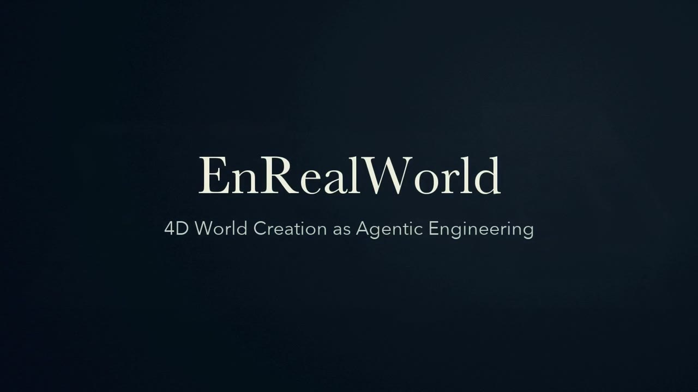

# EnRealWorld

**4D World Creation as Agentic Engineering**

[ Project website](https://zihanguo1024.github.io/EnRealWorld/) · [Watch the project video (2:53)](https://zihanguo1024.github.io/EnRealWorld/#project-preview-video) · [Quickstart](#quickstart)

EnRealWorld builds executable, interactive worlds from inputs such as task descriptions, images, and videos. The Manager turns the input into testable requirements, the Engineer builds and revises the world, and the Researcher independently probes how it responds to interventions. The team uses the resulting evidence to decide what needs repair and what is ready to deliver.

[](https://zihanguo1024.github.io/EnRealWorld/#project-preview-video)

## Install

From the repository root with Python 3.10 or later:

```sh
python -m pip install .
enrealworld --help
```

## Quickstart

Start with one of the [Quickstart inputs](examples/quickstart/README.md). The collection includes a single prompt for three text-to-world scenes, two painting-based tasks, and the measured drawings for three buildings. Every prompt asks the agent to follow the EnRealWorld skill.

## Generate a world

Open the repository root in your coding agent and send the prompt below. Replace the bracketed fields and attach any reference files.

```text
Follow `src/enrealworld/skills/enrealworld/SKILL.md` to set up the run. Use the EnRealWorld team runner (`enrealworld`) to execute the full workflow in independent agent sessions. Use the framework as provided, without modifying it.

Build [describe the scene and the intended interactions] in [target simulator].
Use [attached images, videos, drawings, or local file paths] as references.
The finished scene should [list the behaviors the team should verify].

Deliver a runnable scene with instructions for opening or executing it.
```

You can also run directly from a JSON configuration for your agent adapter and simulation environment. The [EnRealWorld skill](src/enrealworld/skills/enrealworld/SKILL.md) describes the required fields and setup steps.

```sh
enrealworld /path/to/config.json
```

The runner records the delivery status in `result.json` under your configured run directory. Candidate worlds are stored in `candidates/`. Role reports and evidence are stored in `<role>/output/`.

## Method and examples


*The three roles co-design, cross-check, and deliberate before delivering an executable world.*


*Worlds generated from a one-sentence prompt, paintings, and measured architectural drawings. [Explore the interactive scenes](https://zihanguo1024.github.io/EnRealWorld/#worlds).*

## License

EnRealWorld's code and documentation are available under the [MIT License](LICENSE). See the original sources for terms that apply to third-party reference materials. [Quickstart source credits](examples/quickstart/README.md#sources)
