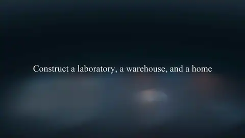
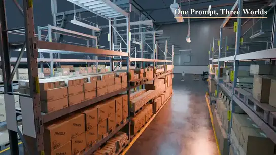
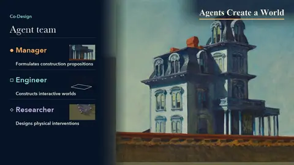
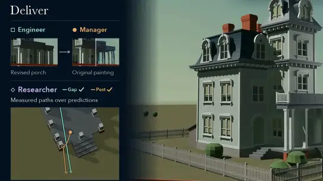
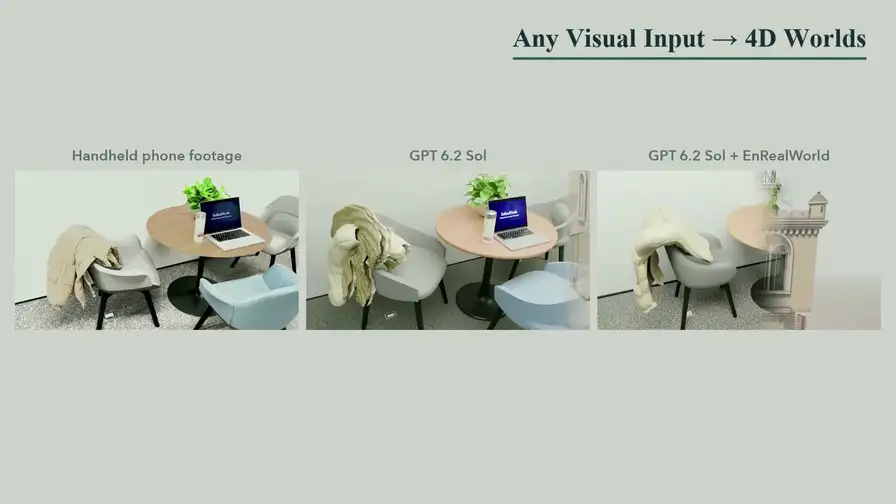
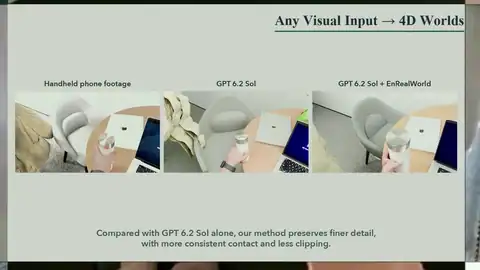
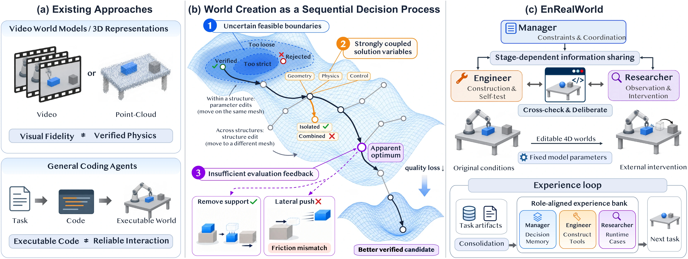
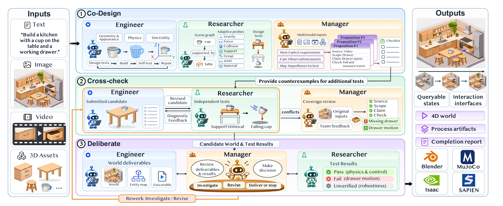
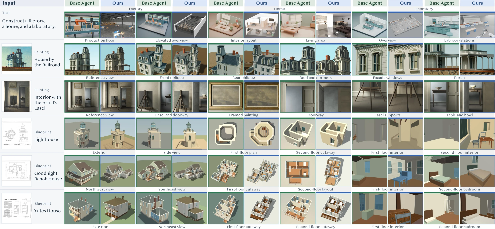

<div align="center">

# EnRealWorld

**4D World Creation as Agentic Engineering**

<a href="https://zihanguo1024.github.io/EnRealWorld/"></a>
<a href="https://zihanguo1024.github.io/EnRealWorld/#project-preview-video"></a>

<a href="#quickstart"></a>

[](LICENSE) [](#install)

</div>

EnRealWorld builds executable, interactive worlds from inputs such as task descriptions, images, and videos. The Manager turns the input into testable requirements, the Engineer builds and revises the world, and the Researcher independently probes how it responds to interventions. The team uses the diagnostic findings to decide what needs repair and what is ready to deliver.

> **Out-of-the-box with your coding agent:** EnRealWorld requires no extra video generation models, 3D Gaussian Splatting optimization, or external 3D generative checkpoints. Install the lightweight Python package and run directly with your coding agent (Codex, Claude Code, Antigravity) and standard physics simulators.

## 🎬 Demos

<table>
  <tr>
    <td align="center" valign="top" width="50%">
      <a href="https://zihanguo1024.github.io/EnRealWorld/assets/video/enrealworld-full-preview-v41.mp4#t=4,12"></a><br>
      <strong>One prompt, three worlds</strong>
    </td>
    <td align="center" valign="top" width="50%">
      <a href="https://zihanguo1024.github.io/EnRealWorld/assets/video/enrealworld-full-preview-v41.mp4#t=32,39"></a><br>
      <strong>Warehouse rack domino</strong>
    </td>
  </tr>
  <tr>
    <td align="center" valign="top" width="50%">
      <a href="https://zihanguo1024.github.io/EnRealWorld/assets/video/enrealworld-full-preview-v41.mp4#t=77.75,135.5"></a><br>
      <strong>House by the Railroad</strong>
    </td>
    <td align="center" valign="top" width="50%">
      <a href="https://zihanguo1024.github.io/EnRealWorld/assets/video/enrealworld-full-preview-v41.mp4#t=136,147"></a><br>
      <strong>Measured drawings to 3D buildings</strong>
    </td>
  </tr>
  <tr>
    <td align="center" valign="top" width="50%">
      <a href="https://zihanguo1024.github.io/EnRealWorld/assets/video/enrealworld-full-preview-v41.mp4#t=149,162"></a><br>
      <strong>Handheld video to 4D reconstruction</strong>
    </td>
    <td align="center" valign="top" width="50%">
      <a href="https://zihanguo1024.github.io/EnRealWorld/assets/video/enrealworld-full-preview-v41.mp4#t=163,169"></a><br>
      <strong>Video2World manipulation tasks</strong>
    </td>
  </tr>
</table>

<a id="reproduce-physical-interventions-no-api-key-required"></a>

## 🧪 Reproduce Physical Interventions (No API Key Required)

From the repository root with Blender 4.5 LTS on your PATH, run both conditions of the [studio bowl-drop test](examples/interventions/studio-bowl/README.md):

```sh
example=examples/interventions/studio-bowl
run_drop() {
  blender --background --disable-autoexec "$example/scene.blend" \
    --python-exit-code 1 --python "$example/replay.py" -- "$1"
}
run_drop table && run_drop floor
```

Each run releases the bowl and checks that it settles within 1 cm of the target surface. For a contact chain, [run the seven-rack MuJoCo example](examples/interventions/warehouse-domino/README.md) or [watch the warehouse showcase](https://zihanguo1024.github.io/EnRealWorld/assets/video/factory-rack-domino.mp4#t=43).

<a id="install"></a>

## 📦 Install

From the repository root:

```sh
python -m pip install .          # Runner and shared schemas
python -m pip install ".[all]"   # Runner with all optional Python tools
```

The base runner supports Python 3.10+. For optional tools, choose a Python version and platform supported by their pinned packages. Install one group with, for example, `python -m pip install ".[constraints]"`.

| Extra | Tools |
| --- | --- |
| `constraints` | Z3 proposition checks (`z3-solver`) |
| `backend-validation` | MuJoCo 3.3.2, NumPy and SciPy for local validation |
| `geometry` | Mesh processing and decomposition with trimesh, Open3D and CoACD |
| `interaction-tools` | Image and video processing with Pillow, imageio and imageio-ffmpeg |

The paper used task-specific simulator environments including Blender 4.0.2 or 5.2.2 LTS, MuJoCo 3.11.0, SAPIEN 3.0.3 with ManiSkill 3.0.1, and Isaac Sim 5.1. Install the target simulator separately when generating worlds.

<a id="quickstart"></a>

## 🚀 Quickstart

Choose a [quickstart input](examples/quickstart/README.md) for text, a painting, or a measured drawing. Open the repository root in your coding agent, attach the inputs, and adapt this prompt:

```text
Follow src/enrealworld/skills/enrealworld/SKILL.md to run the three-role team.
Build [scene and interactions] in [simulator] from the attached inputs.
Verify [expected behaviors] and deliver the runnable scene with instructions.
```

For a local run, choose and configure a [Codex, Claude Code or Antigravity template](examples/configs/README.md). The [EnRealWorld skill](src/enrealworld/skills/enrealworld/SKILL.md) describes the required fields and setup steps.

```sh
enrealworld examples/configs/codex_local.json
```

The runner records the delivery status in `result.json` under your configured run directory. Candidate worlds are stored in `candidates/`. Role reports and test records are stored in `<role>/output/`.

<a id="overview--formulation"></a>

## 🧭 Overview & Formulation



World creation searches a hybrid space $\Omega$ of discrete structures and continuous geometry, physics, and control parameters. Each decision updates the state $z_k=(\mathcal{C}_k,W_k,\mathcal{F}_k) \to z_{k+1}$, which tracks the specification, candidate world, and diagnostic findings.



*The three roles co-design, cross-check, and deliberate before delivering an executable world.*



*Worlds generated from a one-sentence prompt, paintings, and measured architectural drawings. [Explore the interactive scenes](https://zihanguo1024.github.io/EnRealWorld/#worlds).*

<a id="repository-layout"></a>

## 🗂️ Repository layout

```text
src/enrealworld/
├── team/             Three-role runner, scheduling and CLI adapters
├── coordination/     Requirements, scene graphs and role-specific views
├── skills/           Agent instructions, schemas and scripts
└── utils/
    ├── backends/     Simulator-specific helpers
    ├── evolve/       Experience refinement and reuse
    └── validation/   World and interaction checks
examples/             Quickstart inputs, intervention replays and runner configs
```

<a id="license"></a>

## ⚖️ License

EnRealWorld's code and documentation are available under the [MIT License](LICENSE). See the original sources for terms that apply to third-party reference materials. [Quickstart source credits](examples/quickstart/README.md#sources)

<a id="citation"></a>

## 📖 Citation

```bibtex
@misc{guo2026enrealworld,
  title  = {{EnRealWorld}: 4D World Creation as Agentic Engineering},
  author = {Guo, Zihan and
            Song, Yuanyi and
            Yuan, Yuan and
            Cui, Zicai and
            Zeng, Chenxi and
            Shao, Shuai and
            Li, Haoyuan and
            Cao, Qihang and
            Xu, Zunnan and
            Zhou, Dongzhan and
            Zhou, Ming and
            Lin, Jianghao and
            Li, Yang and
            Zhang, Weinan},
  year   = {2026},
  url    = {https://zihanguo1024.github.io/EnRealWorld/}
}
```
