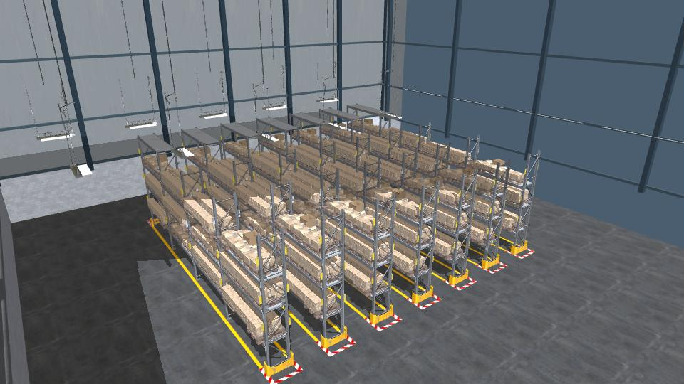

# Warehouse rack domino



The [MuJoCo scene](scene.xml) reuses textured steel frames, shelf decks, end guards, wooden pallets and carton arrangements from the [Warehouse showcase](https://zihanguo1024.github.io/EnRealWorld/assets/video/factory-rack-domino.mp4#t=43). Seven rows share the visual assets under `assets/`. Each row has four bays and three loaded levels. The scene opens independently of the original Blender project.

Each rack is one rigid body. Each of its twelve pallet loads is a separate rigid body, with the cartons fixed to the pallet. Box collision shapes approximate the visible meshes. At 0.50 s, a horizontal force acts on row 1 at a height of 1.68 m for 0.25 s. Subsequent motion comes from simulated contacts. The rack spacing and masses are configured for this replay.

From the repository root, using Python 3.12:

```sh
python -m pip install mujoco==3.3.2
python examples/interventions/warehouse-domino/replay.py --force 0
python examples/interventions/warehouse-domino/replay.py --force 150
python examples/interventions/warehouse-domino/replay.py --force 200
```

To save an eight-second MP4 replay, add `--video`. Video export requires OpenGL and an FFmpeg build with `libx264` on your PATH.

```sh
python examples/interventions/warehouse-domino/replay.py --force 200 --video warehouse.mp4 > warehouse.json
```

| Force | Racks reaching 5° | Racks reaching 45° | Observed response |
| ---: | ---: | ---: | --- |
| 0 N | 0 | 0 | All racks remained upright. |
| 150 N | 1 | 0 | Rows 1 and 2 peaked at 15.3° and 1.2°. |
| 200 N | 7 | 7 | Rows 1–7 crossed 45° in order, from 2.838 s to 4.282 s. |

The JSON reports each rack's peak tilt from vertical, first crossings of 5° and 45°, first load-bearing contact with the preceding row (rack or cargo), and direct applied impulse. Times are measured from the start of the simulation, and `null` means the event was absent during the run.
